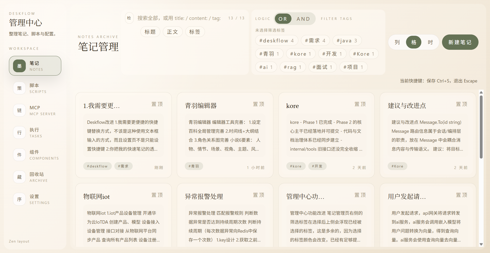
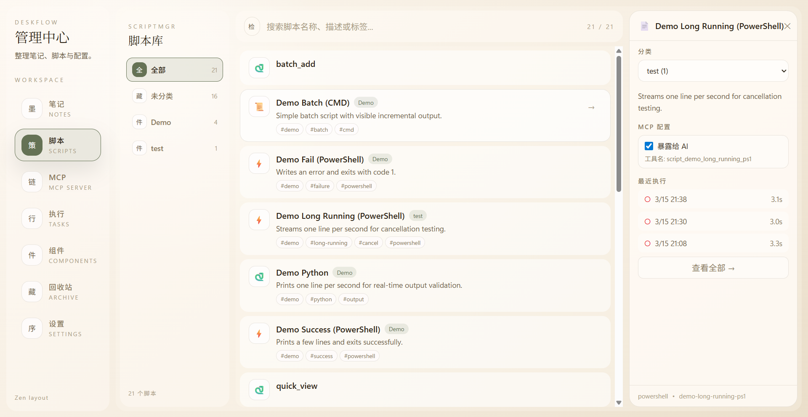

# EasyFlowHub

> 桌面效率工具 - 动作启动器 + 收集箱 + 快速笔记 + 待办管理 + 脚本执行

基于 React、TypeScript、Vite、Tailwind CSS、Tauri、Rust 技术栈的桌面效率工具。

## 界面预览

| 快速笔记 | 笔记管理 |
|:---:|:---:|
|  |  |

| 待办卡片 | 脚本管理 |
|:---:|:---:|
|  |  |

| 设置面板 |
|:---:|
|  |

## 功能特性

### 动作启动器（Launcher）
- 全局快捷键唤起的紧凑面板，支持动作搜索、最近使用、收藏、参数输入与执行反馈
- 内置 Snow Shot 截屏会话入口、一键收集剪贴板内容、剪贴板 / 选中文本翻译
- 支持中键 / 键盘唤起、排除指定软件和鼠标中心定位

### 收集箱（Inbox）
- 文本、链接、图片、文件和录音统一落入本地收集箱，带来源、上下文与时间元数据
- 事务性幂等地“整理为笔记”，支持归档恢复与统一回收站
- 录音后转写（P2，经隐私确认后调用本机 Relay），失败不丢失音频

### 检索与下载
- 指定目录文件搜索：文件名 / 路径 / 扩展名与模糊匹配、最近访问、文本与小图预览
- 打开 / 定位 / 复制路径 / 重命名 / 移动 / 复制 / 回收站删除
- URL 下载队列：`.part` 临时文件、Range 续传、暂停 / 继续 / 取消 / 重试与冲突策略

### 快速笔记
- Markdown 编辑器，支持实时预览
- 全局快捷键 (Ctrl+Alt+N) 快速捕获
- 自动保存 + 标签管理
- 桌面悬浮窗口，支持透明度调节

### 待办管理
- 笔记内嵌 checkbox 语法 (`- [ ]` / `- [x]`)
- 全局待办聚合面板
- 桌面悬浮待办卡片，支持固定到桌面底层
- 已完成项保留期（防误触）

### 脚本管理
- 本地脚本发现与执行
- 执行记录与时间线

### 受控 AI 集成
- OpenAI 兼容 relay 基础配置与 provider health 视图
- MCP 类别管理与 external server catalog 只读展示
- Manifest 扩展贡献聚合与审计入口

### 其他
- 模块化架构，可按需启用/禁用
- 回收站与数据恢复
- 键盘快捷键自定义
- 开机自启动（设置 > 通用）

## 既有 v1.0.0 治理基线

`v1.0.0` 是仓库中保留的发布治理基线，不代表当前安装包版本。当前安装包为 `0.2.0`（见下方 `v0.2.0`），其后仍以 `v1.x` 作为长期平台治理线。

该治理基线的目标不是做成完整平台，而是先交付稳定的桌面主路径：

- quick note、notes manager、todo、scripts、manager/settings 形成可回归闭环
- Windows 打包产物下的多窗口、托盘、自启动、关闭行为稳定
- relay / MCP / extensions 以受控能力纳入，不作为无限扩张的发布阻塞项

明确不在 `v1.0.0` 范围内：

- 云同步、多端协作、账号体系
- 扩展安装 / 卸载、热重载、签名验证
- 在扩展系统中执行任意第三方代码
- 完整的 provider 平台化治理

## v0.2.0 已发布

当前安装包为 `0.2.0`。这一版以个人效率 Hub 为目标，围绕 `Capture -> Understand -> Retrieve -> Act` 加入截屏、翻译、Inbox 快速捕获、文件搜索和资源下载，并将主要页面迁移到可读的 Windows 毛玻璃工作空间。Voice / 转写延期到 `v0.2.x`，不阻塞 v0.2.0 核心发布。

- 发布说明：[docs/releases/v0.2.0.md](./docs/releases/v0.2.0.md)
- 需求基线：[docs/PRD-v0.2.0.md](./docs/PRD-v0.2.0.md)
- 实施计划：[docs/plans/2026-10-16-v0.2.0-product-delivery-plan.md](./docs/plans/2026-10-16-v0.2.0-product-delivery-plan.md)
- 视觉与入口决策：[docs/decisions/ADR-0004-glass-theme-and-efficiency-workspace.md](./docs/decisions/ADR-0004-glass-theme-and-efficiency-workspace.md)

## 文档入口

- 当前执行需求基线：[docs/PRD-v0.2.0.md](./docs/PRD-v0.2.0.md)
- 既有发布治理基线：[docs/PRD-v1.0.0.md](./docs/PRD-v1.0.0.md)
- 当前执行状态：[docs/roadmap.md](./docs/roadmap.md)
- 项目画像与验证命令：[docs/PROJECT_PROFILE.md](./docs/PROJECT_PROFILE.md)
- 架构边界：[docs/ARCHITECTURE_GUARDRAILS.md](./docs/ARCHITECTURE_GUARDRAILS.md)

## 技术栈

| 层 | 技术 |
|---|---|
| 前端 | React 19, TypeScript, Vite, Tailwind CSS |
| 桌面 | Tauri 2, Rust |
| 存储 | SQLite (rusqlite) |
| 平台 | Windows |

## 开发

```bash
# 安装依赖
cd easyflowhub-app
bun install

# 启动开发
bun tauri dev

# 构建
bun tauri build
```

## 快捷键

| 快捷键 | 功能 |
|--------|------|
| Ctrl+Alt+N | 新建快速笔记 |
| Ctrl+Alt+M | 显示/隐藏管理窗口 |
| Ctrl+Alt+Space | 打开 Action Launcher（可在设置中重录） |
| Ctrl+Alt+D | 关闭所有快速笔记 |
| Ctrl+Alt+H | 隐藏/显示所有快速笔记 |

## 项目结构

```
easyflowhub/
├── easyflowhub-app/           # Tauri 主应用
│   ├── src/                   # React 前端
│   │   ├── components/        # UI 组件
│   │   ├── hooks/             # React Hooks
│   │   ├── lib/               # 工具函数
│   │   ├── modules/           # 功能模块
│   │   └── types/             # TypeScript 类型
│   └── src-tauri/             # Rust 后端
│       └── src/
│           ├── lib.rs          # 主入口
│           ├── notes.rs        # 笔记模块
│           ├── settings.rs     # 设置模块
│           ├── scriptmgr.rs    # 脚本管理
│           └── mcp_server.rs   # MCP 服务器
├── docs/                      # 文档
└── image/                     # 截图资源
```

## License

MIT
