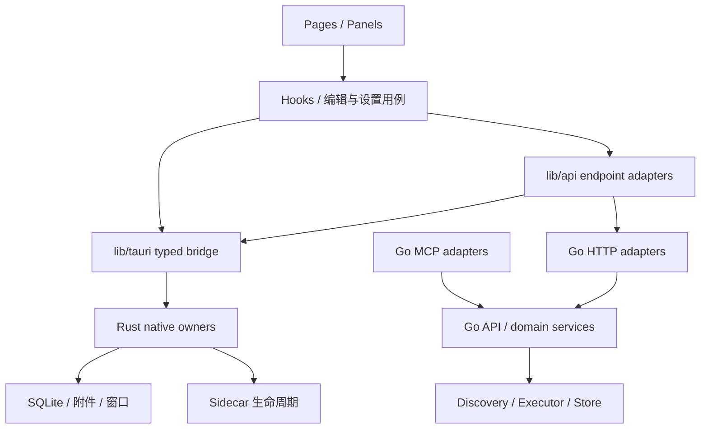

# 架构与大文件审查

> 审查日期：2026-10-19
> 基线：`d1a95f0` 加本地工作区；包含原有 SettingsPanel、QuickNotePage、useAutoSave 和 smoke 脚本未提交改动
> 状态：审查完成；阶段A（F01–F05）、阶段B（F06–F14）与阶段C（F11 + 第5节大文件拆分）均已实施并完成自动化回归；2026-10-20 补齐待办箱跨窗口原子创建、自动保存导航竞态、Go 锁跨进程子进程回归及回收站部分响应，并完成 F11 与四项大文件拆分；阶段D（V1-F5 CI 门禁）亦已建立（架构门禁脚本 + Windows native PR 检查），四个阶段全部完成
> 范围：`easyflowhub-app/src`、`easyflowhub-app/src-tauri/src`、`scriptmgr-go`、验证链及架构文档

## 1. 结论

现有 React / typed bridge / Rust native / Go sidecar 的总体方向可以保留，不需要重写或拆成微服务。Manager registry、Action registry、relay 选路、manifest 扩展和纯解析器已有明确 owner；前端静态依赖分析也没有发现循环。

目前还不能判定已经满足高内聚、低耦合和数据完整性要求。主要问题是编辑会话、任务状态、资源生命周期和配置提交仍有多个写入方；部分大文件把不同生命周期的职责放在一起，异常路径已经暴露数据丢失或误写风险。应先修复 F01–F05，再在既有 owner 内拆分，避免把相同问题分散到更多文件。

本文件保留 2026-10-19 的审查基线与原始证据。后续跟进已在既有 owner 内完成阶段 A/B 修正；文末补充当前实现与验证边界，原审查中的“建议接口”不代表仍未实现。

## 2. 规模与依赖证据

- 扫描 TS / TSX / Rust / Go / CSS 共 282 个文件；排除独立测试文件后为 216 个。
- 24 个实现文件物理行数超过 500，5 个超过 1000；再剔除 Rust `#[cfg(test)]` 区域后，约为 23 个超过 500、4 个超过 1000。行数包含空行和注释，只作为定位信号。
- 使用项目 TypeScript resolver 检查 145 个非测试 TS / TSX 文件，得到 352 条内部 import / export 边（包含字面量动态 import 和类型引用），没有发现强连通循环；未发现 `lib -> features/components` 或 `features -> manager components` 的静态引用。
- 上述结果不覆盖字符串拼接加载、事件、原生命令和多进程状态耦合，不能据此推导运行时完全解耦。
- `lib/tauri` 外仍有 9 处直接 `invoke`：QuickNotePage 2 处、TodoCardPage 2 处、TitleBar 1 处、modules/registry 3 处、lib/api/scriptmgr 1 处。这是 owner 规则偏离；不代表这些调用全部已经发生运行错误。

| 文件（相对仓库根目录） | 总行数 / 去测试约数 | 判断 |
|---|---:|---|
| `scriptmgr-go/internal/mcp/server.go` | 1487 / 1487 | 优先：协议、schema 注册、各域 handler、通知与任务等待混合 |
| `easyflowhub-app/src/components/manager/SettingsPanel.tsx` | 1318 / 1318 | 优先：单组件函数 1246 行，多域草稿、保存、副作用及视图绑定 |
| `easyflowhub-app/src-tauri/src/inbox.rs` | 1459 / 1159 | 优先：迁移、附件、采集、转笔记和删除的生命周期不同 |
| `easyflowhub-app/src-tauri/src/lib.rs` | 1111 / 1111 | 优先：组合根兼任选区、鼠标 hook、快捷键和多个窗口 owner |
| `easyflowhub-app/src/pages/QuickNotePage.tsx` | 924 / 924 | 应拆：编辑会话、切换、图片、工具面板与窗口交互 |
| `easyflowhub-app/src/components/manager/NotesPanel.tsx` | 779 / 779 | 应拆：列表查询和编辑会话分离，复用已有视图组件 |
| `easyflowhub-app/src/pages/TodoCardPage.tsx` | 744 / 744 | 应拆：与 TodoPanel 重复业务编排，浮窗行为单独保留 |
| `easyflowhub-app/src-tauri/src/file_search.rs` | 1084 / 965 | 次级：索引、查询和文件操作可包内分离，仍保持一个领域 owner |
| `easyflowhub-app/src-tauri/src/download.rs` | 988 / 830 | 次级：任务状态、网络传输和目标文件提交可包内分离 |
| `scriptmgr-go/internal/relay/service.go` | 687 / 687 | 可暂接受：选路、代理、failover、health 属于同一请求链 |
| `easyflowhub-app/src-tauri/src/transcription.rs` | 543 / 331 | 不因总行数强制拆分，212 行是内联测试 |

大型协议测试、schema 和 DTO 不应仅因行数被拆散。拆分依据是变化原因、状态归属和可独立验证的边界。

## 3. P1：数据完整性，优先修复

### F01 任务状态以全局旧快照覆盖，跨进程任务可能丢失

- 证据：`scriptmgr-go/internal/executor/async.go:136` 读取整个 sessions；`:171` 执行脚本；`:187–189` 在完成后写回执行前的整个列表。`internal/store/store.go:86–95` 没有跨进程更新协调。Start、ListSessions 也有整表读改写。
- 影响：A 运行期间创建 B，A 完成会把 B 从 sessions.json 中抹去；两个 worker 的完成/取消状态也可相互覆盖。sessions.json 与 tasks.db 另存两套状态，`async.go:311` 附近同步又忽略数据库错误。
- owner：`internal/store` 负责按任务 ID 原子迁移；executor 负责执行和发出状态变化。优先利用已有 SQLite 统一任务事实，或提供跨进程锁内的读改写；仅加进程内 mutex 不能解决 worker 进程竞争。
- 验收：两个 worker 交错启动、完成、取消后全部记录仍存在；存储错误可见；各读取接口得到相同终态。

### F02 回收站 manifest 写失败，会删除脚本唯一副本

- 证据：`scriptmgr-go/internal/api/scriptfiles.go:316` 已将原脚本移入回收站；`:323–325` 若写 entry.json 失败，直接 RemoveAll 整个回收站条目。`:321` 和 `:379` 还忽略 metadata 移动错误。
- 影响：本应可恢复的“删除到回收站”在失败清理时变成永久删除。
- owner：在 Go 脚本文件领域内统一源码、metadata、暂存、提交和恢复；API facade 只编排调用。失败后回滚原路径，或保留可恢复暂存，不能删除唯一副本。
- 验收：注入 manifest 写失败、metadata 移动失败、跨盘复制/删除失败，保证至少一份可恢复副本及明确的操作结果。

### F03 Inbox 迁移非事务化，失败后还会跳过恢复

- 证据：`easyflowhub-app/src-tauri/src/inbox.rs:155–182` 重命名、建表、复制和删旧表没有 BEGIN / COMMIT；`:150–154` 仅以新表 CHECK 内容判断完成；`:185–188` 从命令连接路径触发初始化。
- 影响：附件复制失败时，新表已经含 audio / transcript，下一次初始化误判已迁移，旧附件留在 legacy 表而业务读不到。
- 复现：对子代理读取的原始 SQL 在内存 SQLite 注入附件复制失败，得到“新附件表 0 行、legacy 1 行、下一次迁移条件 false”。这是故障注入，未操作用户数据库。
- owner：迁移底座在 native storage 内统一，启动时串行执行；事务成功后再提交 schema version。Inbox 持有自己的表和仓储规则，不让每个命令承担迁移编排。
- 验收：每个迁移阶段失败均可回滚，重启可重试，数据、外键与索引保持完整。

### F04 自动保存缺少编辑版本与会话隔离，旧响应回写新草稿

- 证据：`easyflowhub-app/src/hooks/useAutoSave.ts:35–48` 保存返回后无条件删除该 note 的备份、调用 onSaved；`:81–90` 旧定时器 finally 无条件清空共享 ref。`components/manager/NotesPanel.tsx:244–248` 无条件将响应重新填入当前编辑草稿。QuickNotePage `:95–103` 同样不检查当前 note 会话。
- 影响：保存 A 等待期间输入 B，A 返回后删除 B 的备份，Manager 草稿被回填 A；旧请求还可清空 B 的待保存标记，关闭时 flush 错判无任务。切换笔记也缺少会话隔离。
- 复现：内存 harness 执行真实 hook 转译代码，注入受控 saveNote Promise；B 备份在 A 完成后变空，onSaved 收到 A，flush(B) 返回 null，但 B 的 timer 仍在队列。未运行实际窗口。
- owner：`useAutoSave` 统一持有按 note / session 隔离的 pending、in-flight 和 revision；串行或合并保存，只允许匹配版本确认草稿与清除备份，flush 等待真实队列。
- 验收：慢保存时继续输入、请求反序、切换笔记、退出时保存失败、备份恢复均有 deferred Promise 回归。

### F05 两个待办入口复制写入编排，旧行号会修改其他条目

- 证据：`components/manager/todos/TodoPanel.tsx:73–77,109–121` 与 `pages/TodoCardPage.tsx:194–198,277–287` 都把旧列表的 lineIndex 用于刚读取的最新正文。`lib/todoParser.ts:74,107` 只检查该行是不是 checkbox。
- 影响与复现：旧列表 A、B 的 A 在第 0 行；另一个窗口在顶部插入 inserted。真实 parser 会把 inserted 勾选，编辑 A 则覆盖 inserted 文本。
- owner：共享 todo 用例/hook 负责加载、保留期、修改与刷新，parser 保持纯函数；native notes 持久化提供 revision / compare-and-swap，避免读写之间再次变化。只抽重复 JSX 无法修复。
- 验收：多窗口插入/删除行、重复同名待办、同时编辑时拒绝冲突或正确定位，不能静默改错任务。

## 4. P2：恢复、owner 与职责边界

| ID | 证据与影响 | 建议边界与验收 |
|---|---|---|
| F06 sidecar 两层永久就绪缓存 | `src/lib/api/scriptmgr.ts:61–80,107–122` 成功 Promise 永久缓存，网络失败不失效；native `scriptmgr_server.rs:204–205` 成功后直接返回 URL。sidecar 退出后无法通过正常重试恢复。内存 API harness 先成功再连续失败，3 次调用只 invoke 1 次。 | Rust 独占进程生命周期，检查退出并恢复；TS 只共享进行中的 ensure，失效后重新握手。验证杀进程、并发重连与启动失败；不要自动重放有副作用请求。 |
| F07 模块配置失败回滚丢失旧值 | `src/modules/registry.ts:109,121,126` 失败时 delete 配置，而不是恢复原 enabled。实测 scripts 持久值 true、默认 false，保存失败后变为 false，且无订阅通知。 | registry 通过可注入持久化接口提交，失败恢复确切旧值，处理并发 toggle；UI 显示失败。测试已配置模块的保存失败与连续切换。 |
| F08 设置提交同时存在多域耦合和非原子写入 | SettingsPanel `:349–372` 普通设置保存携带未提交 Launcher 草稿；native `settings.rs:508–608` 8 次独立写入；专用 `lib.rs:718–719` 先改运行态再保存。会出现局部保存、落盘未应用或应用未落盘。 | 设置分域提交；普通保存不能夹带 Launcher 草稿。Launcher service 统一校验、应用、持久化和失败补偿；数据库事务写入。验证第 N 次写失败、快捷键冲突、重启前后一致。 |
| F09 HTTP 另建 MCP loaded 状态 | `internal/http/server.go:55,420–441` 只改本地 loadedCategories，不操作 `internal/mcp/router.go:203`；`:368–379` 解锁后仍读取 map。界面成功标记不代表真实工具可用，并有并发读写风险。 | MCP runtime 是加载状态 owner，HTTP 注入窄管理接口。不同进程需定义管理契约，不能用布尔标记模拟成功。验证 HTTP load/unload 与真实 tools/call 一致，并做并发 race 检查。 |
| F10 录音资源缺少统一身份，永久删除漏掉原件 | native `voice.rs:275` 写 audio/session-id.wav，`inbox.rs:568` 给附件副本新 UUID；`:1112,1140–1141` 用附件名删除两个目录，无法命中原始音频。 | 附件归档记录 source 与 canonical attachment 的明确关系，由资源 owner 管理删除/引用保留。验证未转笔记项彻底清理、已转笔记资源继续可用。 |
| F11 MCP 大文件持有业务等待并重复定义协议 | `internal/mcp/server.go:88`、`schema.go:17`、`server.go:488` 多处维护注册/schema/fallback；`:1305–1344` 的等待只累加计数，没有实际等待，却报告 60 秒超时。 | 同包拆 protocol、registry、各域 handlers、notifications；从一个 registry 派生 schema 和 handler。等待由 API/executor 的可取消用例持有。用可控时间验证完成/超时/取消和 schema-handler 一致性。 |
| F12 脚本分类没有统一有效视图 | `internal/api/api.go:33–50` 应用 override，`:54–95` 分类统计/过滤直接查 discovery；MCP router 又自行统计过滤。列表、分类计数和 MCP 可出现不同分类。 | API/领域层提供 effective catalog，discovery 只做原始发现，HTTP/MCP 消费同一视图。验证设置/清除 override 后各入口一致。 |
| F13 扩展查询通过 relay 绕行 | `internal/http/server.go:111,390–400` 将 extension 路由和 MCP contribution 查询绑定 relay 服务。无关的 relay 配置/可用性会影响扩展清单。 | CLI 组合根独立注入 extension contribution、MCP catalog 和 relay 的窄接口；relay 仅消费自己的贡献。验证不初始化 relay 时仍能查询扩展/MCP catalog。 |
| F14 Voice 终态有多个写入方 | native `voice.rs:477–478` 收到 pause/resume 回执后无条件更新状态，worker `:106–114` 可先置 failed 并清通道，终态随后被覆盖。`:554–587` 的 FakeBackend 重写了状态机，没有验证生产转移。 | actor 单独写会话状态，命令只发事件；fake 仅替代硬件/IO，复用生产状态转移。验证回执后失败、pause/stop 并发、超时、终态不可回退。 |

本表中 `src/...` 相对 `easyflowhub-app`，`internal/...` 相对 `scriptmgr-go`，native 文件相对 `easyflowhub-app/src-tauri/src`。这些问题来自状态和协议边界，不能通过单纯减少文件行数关闭。

## 5. 拆分方案：保持 owner，缩小变化范围

| 目标 | 保留职责 | 提取边界 | 不变量 |
|---|---|---|---|
| SettingsPanel | 导航、分区组合、页面级反馈 | `manager/settings/*Section`；各设置域的加载/草稿/提交 hook | 每个配置域一个提交入口，Launcher 不随普通设置被动提交 |
| QuickNotePage / NotesPanel | 各自页面组合及窗口特有交互 | 编辑会话、笔记切换、备份、附件操作；继续复用 useBackupRestore、history / image hooks 和 NoteEditor | 保存版本和 flush 只归 useAutoSave；SQLite CRUD 仍归 native notes |
| TodoPanel / TodoCardPage | 列表/浮窗各自视图与生命周期 | 共享 todo 加载、筛选、toggle/edit 用例 | lib/todoParser 继续唯一解析 owner；写入有冲突检测 |
| native lib.rs | `run()`、插件装配、state 注入、命令注册 | Launcher selection/trigger/window；notes/todo/manager window 行为 | 不把窗口生命周期迁到 UI，也不复制 Go 脚本业务 |
| native inbox.rs | Inbox 领域门面 | schema/migrations、attachments、repository、capture/conversion service、commands | 同一资源身份与事务策略，命令不各自重复实现 |
| Go mcp/server.go | 协议入口 | protocol、registry、tools_scripts、tools_notes、tools_tasks、notifications | 同一 mcp 包内组织，依赖注入已有 API，不新增执行引擎 |
| Go api/scriptfiles.go | API 调用门面 | script file service 的路径策略、原子写、trash 提交与恢复 | 源码和 metadata 生命周期统一，失败保留可恢复副本 |
| src/lib/api/scriptmgr.ts | 对外兼容导出 | HTTP transport、各域 endpoint adapters；native ensure 进入 lib/tauri | 一个就绪/重连策略；统一 wire-format 归一化，无 UI 状态 |

期望依赖形态（展示两条真实通信路径；Go HTTP 不必全部经 Rust 转发）：

`modules/builtin` 继续作为 Manager 面板组合根，`modules/runtime` 保持纯 registry/hooks 入口；`features/actions` 继续只持有动作契约和注入的 executor，不与 Manager module registry 合并。

## 6. 分阶段实施与验收

| 阶段 | 工作 | 关闭条件 |
|---|---|---|
| A：数据完整性 | F01–F05，优先回收站/迁移/保存异常保护；每项独立变更 | 故障注入、多 worker、多窗口并发回归通过；无唯一副本删除、静默错写 |
| B：单一状态 owner | F06–F10、F12–F14；typed bridge 收口 | sidecar 可恢复；模块、配置、MCP、资源状态与真实运行结果一致 |
| C：大文件拆分 | 先 SettingsPanel、mcp/server，再 native inbox/lib 和编辑页面；F11 的等待策略单独修复 | 对外接口保持兼容，按职责独立验证；没有平行 owner 或新循环 |
| D：持续约束 | CI import/bridge/规模基线、Windows Rust 验证、同步模块文档 | 新违规可自动阻止；既有债务只减不增；文档与实际通信路径一致 |

建议的仓库约束，不作为通用软件工程标准：实现文件超过 500 行触发职责 review，超过 800 行应有拆分任务或明确豁免；复杂状态型组件在 300 行附近复核变化原因。统计剔除测试和生成代码，schema/DTO/组合根可有理由豁免。不要用“全部低于阈值”替代数据完整性和 owner 验收。

持续检查应覆盖：TS 解析后的 import 循环与反向依赖、非 bridge 原始 invoke（先按现有 9 处建带清理任务的基线）、文件规模增量、schema-handler 配对。当前 `.github/workflows/test.yml` 只有前端/Go 作业，缺 Windows native PR 检查；本地 smoke 有 Rust 检查和测试，但不能代替 PR gate。

实施时同步 `ARCHITECTURE_GUARDRAILS.md` 的两条通信路径、对应 `MODULE.md` 和必要 ADR；阶段 A/B 跟进仍沿用既有 owner，没有引入平行实现。现有 AGENTS 仍以 v1.0.0 为需求入口，docs/README 与 PROJECT_PROFILE 又把 v0.2.0 作为当前执行线，此口径应在治理任务中统一，本审查不擅自调整版本策略。

## 7. 本轮验证与限制

| 验证 | 结果 |
|---|---|
| `bun run test` | 45 个文件，330 项通过 |
| `bunx tsc --noEmit` | 通过 |
| `go test ./...` | 267 项通过，20 个包 |
| `go vet ./...` | 通过 |
| `cargo check --manifest-path src-tauri/Cargo.toml` | 通过 |
| `cargo test --manifest-path src-tauri/Cargo.toml --lib` | 76 项通过 |
| 针对异常的内存验证 | module toggle 失败回滚、sidecar 就绪缓存、todo 旧行号、autosave 旧响应、Inbox migration 故障注入证据见上文 |

Rust 保留已有 NoteInput 未使用字段和 incremental lock 清理权限提示。未运行真实 Windows 打包多窗口、麦克风、第三方服务和杀 sidecar 集成 smoke；没有执行完整 race 测试，也未重新打包。这些是审查限制，不能把单测通过解释为已修复上述问题。

## 8. 阶段 A/B 跟进修正

- F01：`internal/store` 的 sessions/history 读改写使用跨进程锁；`executor` 按 session ID 更新并补偿启动失败，新增真实 OS 子进程锁回归。仍需 Windows 打包态多 worker smoke。
- F02：回收站脚本、metadata 与 manifest 失败路径保留可恢复副本，manifest 原子写入；损坏条目不再静默丢弃，HTTP 列表返回有效条目并带 warning。
- F03：Inbox 迁移保持事务化实现与现有回滚测试。
- F04：自动保存按 token 串行化；manager 导航在切换前 flush，旧请求在异步加载、关闭和晚响应路径均不能覆盖新会话。
- F05：todo 写入继续由 `useTodos` 统一编排，native CAS 保护正文更新；待办箱初始化新增 `ensure_todo_inbox_note`，由 SQLite `BEGIN IMMEDIATE` 在跨窗口下原子复用或创建，前端不再组合 `list -> create -> save`。

本轮定向验证已覆盖前端待办/自动保存/manager 导航、Rust notes 原子待办箱、Go store 跨进程锁、Go 回收站 API 与 HTTP partial response；全量前端 47 个测试文件 / 359 项、Rust 88 项、Go `./...`、TypeScript、`cargo check` 和 `go vet` 均已重跑通过。真实 Windows 多窗口/打包态 smoke 仍是发布前验收项。

## 9. 阶段 C 跟进：F11 与大文件拆分

- **F11**：`internal/mcp/server.go`（1364 行）拆为 `protocol.go` / `tools_{scripts,notes,categories,tasks}.go` / `notifications.go` + 收敛后的 `server.go`（装配 + 单一 registry）。`get_task_result(wait=true)` 的等待由只累加计数的空转改为真实、可取消的有界轮询（`taskWaiter`，注入 `sleep` 便于可控时间验证完成/超时/取消）；schema 与 handler 从同一来源派生（`GetToolSchemas()` + `registerStaticTools`），router 是唯一 dispatch owner，移除 legacy switch fallback 与 4 个未实现的 note-repo schema。新增等待完成/超时/取消/取错与 schema-handler 一致性回归。
- **第5节大文件拆分（保持 owner 与接口兼容）**：
  - SettingsPanel（1318→213）→ `components/manager/settings/*`（分域 Section + hook）；并修复 F08 的 UI 半边：普通保存不再夹带未提交 Launcher 草稿。
  - native `inbox.rs`（1769）→ `inbox/{schema,attachments,repository,service,commands}`；`lib.rs`（1112→306）收敛为装配根，抽出 `launcher`/`app_windows`/`window_position`。102 个 Tauri 命令名与 `invoke_handler` 集合保持不变。
  - 编辑页面：抽出 `useQuickNoteSession`/`useNotesArchive`/`useTodoGroups`/`useTodoEditSession`，NotesPanel 收敛为 tab 壳，页面只保留窗口交互与渲染；保存版本仍归 `useAutoSave`、todo 写入仍归 `useTodos`、解析仍归 `lib/todoParser`。
- **验证**：前端 52 文件 / 381 项 + tsc、Go `./...` + vet、Rust 88 项 + `cargo check` 均通过。QuickNotePage(657)/TodoCardPage(532) 仍略超 500 行阈值，余量为内联 JSX，可作后续展示层拆分；真实 Windows 打包态 smoke 仍待人工执行。

## 10. 阶段 D 跟进：持续门禁

- `scripts/check-architecture.mjs`（Node 内置，无第三方依赖）在 PR 上拦截：静态 import 环；`lib` 反向依赖 `features/components/pages/modules`、`features` 反向依赖 `components/pages`；`src/lib/tauri` 之外的原始 `invoke()`（按 `scripts/architecture-baseline.json` 基线只减不增）；实现文件规模债（>500 行只减不增、>800 行硬门禁需拆分或显式豁免）。`--update-baseline` 用于债务合法缩减后重新快照。
- schema-handler 配对由 Go 测试 `internal/mcp/f11_test.go` 的 `TestStaticSchemasAllHaveRegisteredHandlers` 覆盖（随 `go test` 运行），保证 advertised schema 一定有可调用 handler。
- `.github/workflows/test.yml` 新增两个 PR 门禁：`architecture-gates`（ubuntu，运行上述 guard）与 `native-windows`（windows-latest，`cargo check` + `cargo test --lib`），补齐审查 §6 指出的缺失 Windows native PR 检查；本地 smoke 仍不能替代 PR gate。
- 当前基线：`lib/tauri` 外原始 invoke 3 处（TitleBar、TodoCardPage×2）；>500 行债务 2 个文件（lib/api/scriptmgr 596、TodoCardPage 533）；>800 行 0 个。既有债务只减不增。
- `2026-10-21` 发布前检查清除了规模债阻塞：`QuickNotePage` 的快捷键映射抽为 `hooks/useQuickNoteShortcuts`，切换器 / 工具栏 / 工具面板 / 图片条抽为 `components/shared` 组件，`toggle_always_on_top`、`hide_window`、`close_window` 收入 `lib/tauri/window.ts`，页面 658 → 423 行、原始 invoke 降到 3 处；`TrashPanel` 拆为 `components/manager/trash/{TrashNotesView,TrashInboxView,TrashScriptsView,trashShared}`，面板 530 → 209 行。两份债务均回落到 500 行阈值内，基线以 `--update-baseline` 重新快照（QuickNotePage 的 invoke 与 sizeDebt 条目已移除）。
